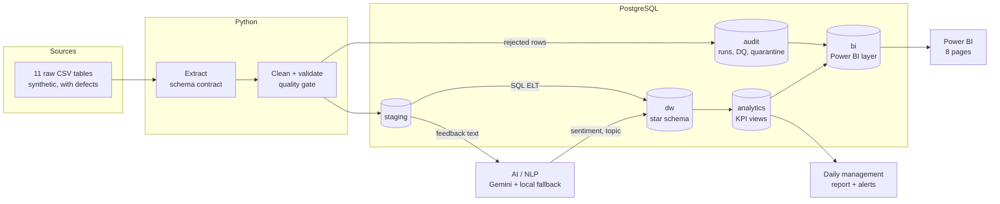
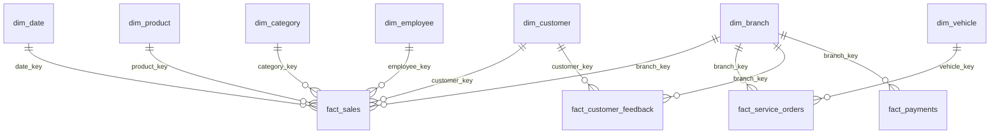

# AutoSphere Analytics: Business Intelligence & AI Analytics Platform

An end-to-end BI and AI platform for **AutoSphere Analytics**, a *fictional* automotive
company with eight branches in Tbilisi, Batumi, Kutaisi, Rustavi and Zugdidi (Georgia). The
company sells vehicles, parts and accessories, runs service centres, and collects customer
feedback in Georgian and English.

> **Portfolio project.** The company is fictional and all data is synthetic, generated
> locally with a fixed seed. No real company, customer or employee data is used.

  

**Contents:** [Business problem](#business-problem) · [Architecture](#architecture) · [Stack](#technology-stack) ·
[Data](#data-sources) · [ETL](#etl--elt) · [Warehouse](#data-warehouse-and-star-schema) · [Data quality](#data-quality) ·
[KPIs](#kpi-layer) · [Power BI](#power-bi) · [AI/NLP](#ainlp) · [Reporting](#automated-reporting) ·
[Run it](#how-to-run) · [Tests](#how-to-run-the-tests) · [Questions and insights](#example-analytical-questions) ·
[Limitations](#limitations) · [Future work](#future-improvements) · [Docs](#documentation)

---

## Business problem

Management needs **one trusted view of sales, service and customer satisfaction** across
branches, refreshed automatically, so that problems are noticed in weeks rather than at year end.

The obstacles are typical of real companies:
- **Messy operational data.** Duplicates, misspelled cities, invalid IDs, three date formats, negative quantities.
- **Unreadable feedback at scale.** Customer feedback is free text in two languages; 10,000 comments can't be read by hand.
- **Conflicting numbers.** Different reports calculate KPIs differently, so meetings argue about numbers instead of decisions.

**What the platform delivers:**

| For | What they get |
|-----|---------------|
| Management | A daily one-page report with alerts, and an executive dashboard |
| Branch and service managers | Comparable branch performance, service turnaround, complaint drivers |
| Quality / CX | *Why* customers are unhappy (AI topics), where, and since when |
| BI team | Proof that every number is right: quality gates, reconciliation, audit trail |

## Architecture



Every layer has a quality gate. A CRITICAL failure rolls the load back, so dashboards keep
the last good data. Details: [docs/architecture.md](docs/architecture.md).

## Technology stack

| Area | Tools | Why |
|------|-------|-----|
| Language | Python 3.11 (pandas, SQLAlchemy, psycopg2) | Cleaning logic that is easy to read and unit-test |
| Database / DWH | PostgreSQL (managed, or local via Docker Compose) | Free; window functions, materialized views, JSONB, native Power BI connector |
| Transformations | Python (row-level cleaning), SQL (modelling, KPIs) | Each tool where it is strongest |
| BI | Power BI, DAX | Semantic model, time intelligence, sharing |
| AI / NLP | Google Gemini (structured output), deterministic rule-based fallback | Bilingual understanding; works without a key |
| Automation | Windows Task Scheduler, cron, GitHub Actions | Any of the three runs the same job |
| Testing | pytest, pytest-cov, GitHub Actions CI | 236 tests, 89% coverage |

## Data sources

Eleven related tables are produced by a deterministic generator (`datagen/`, seed 42,
period 2024-01-01 – 2026-09-30):

| Master data | Transactions |
|-------------|--------------|
| branches (8), product categories, products (42), employees (~90), customers (5,000), vehicles (2,000) | sales lines (~32k), service orders (~11k), service items (~27k), payments (~25k), customer feedback (~10.5k, Georgian + English) |

The generator builds in **business stories** for the analysis to find: Kutaisi declining in
2026, Batumi's service slowing down, price complaints rising. It also injects **38 types of
data defects**, recorded in a manifest so their detection can be proven. See
[data/README.md](data/README.md).

## ETL / ELT

A 9-step pipeline (`python scripts/run_pipeline.py`, code in `etl/pipeline.py`):

| # | Step | Where |
|---|------|-------|
| 1 | Extract CSVs as text, check schema contract | `etl/extract/` |
| 2 | Clean and normalise (cities, dates, numbers, categories); quarantine invalid rows with a reason | `etl/transform/` |
| 3 | **Source quality gate**: invalid-row rate per table (warning > 2%, critical > 10%) | `etl/validation/` |
| 4 | Write processed files | `data/processed/` |
| 5 | Load staging + quarantine + **post-load checks**, in one transaction | `etl/load/` |
| 6 | AI enrichment of new or edited feedback | `ai/pipeline.py` |
| 7 | Build the star schema (SQL) + **warehouse checks**, in one transaction | `database/warehouse/` |
| 8 | Rebuild KPI and Power BI views + **reconciliation checks** | `database/views/` |
| 9 | AI insights from SQL facts | `ai/insights.py` |

**Hybrid by design:** messy row-level cleaning in Python (ETL); dimensional modelling and
KPIs in SQL inside the database (ELT). See [docs/etl.md](docs/etl.md).

## Data warehouse and star schema



- **5 facts at explicit grains:** sales line, service order, service line, payment, feedback (with AI columns).
- **7 conformed dimensions:** one Branch filter applies to sales, service, payments and complaints together.
- **Surrogate keys** with **Unknown (-1)** and **Not applicable (-2)** members. A sale with missing master data stays in revenue instead of disappearing.
- **SCD Type 2 customers.** Facts use the customer version valid at the transaction date (`python scripts/demo_scd2.py`). Other dimensions are SCD Type 1.
- Idempotent rebuild with stable keys.

See [docs/data-model.md](docs/data-model.md).

## Data quality

- **A framework, not ad-hoc checks.** Declarative SQL rules with severities INFO, WARNING and CRITICAL, run at four gates: source, staging, warehouse, analytics/Power BI. That is **340 checks per run**.
- **Nothing disappears silently.** Every invalid row is quarantined in `audit.rejected_rows` with its reason and raw content. In every table, *raw rows = staging rows + quarantined rows*.
- **Bad data never replaces good data.** A CRITICAL failure rolls back the load, and the report says so.
- **Proven.** A test shows that each of the 38 injected defect types is detected.

See [docs/data-quality.md](docs/data-quality.md).

## KPI layer

KPIs are defined once, in SQL views (`analytics` schema), and documented in the
[KPI dictionary](docs/kpi-dictionary.md): revenue, profit, margin, orders, AOV, repeat
customer rate, service revenue, YTD / YoY / MoM growth, RFM segments, turnaround, negative
feedback rate.

Two rules prevent classic BI mistakes:
- **AOV divides by orders, not lines.** Revenue counts completed sales only.
- **Comparable periods.** Data ends in September 2026, so growth compares year-to-date with the same window last year (**+15.6%**). A naive full-year comparison would show **−18.5%**. Annual growth is shown only between complete years.

Every KPI is computed **three independent ways** (view, stand-alone SQL, pandas) and compared
in tests. Ten business-question queries live in [analytics/sql/](analytics/README.md).

## Power BI

| | |
|--|--|
| Source | Only the `bi` schema: 17 views forming a stable, privacy-filtered contract (no e-mail, phone or VIN) |
| Model | Star schema, single-direction relationships, one inactive relationship (service close date), Import mode |
| Measures | 79 DAX measures: sales, time intelligence, comparable YTD, service, payments, AI feedback, data quality |
| Pages | Executive, Sales, Branches, Products, Customers, Service, **Customer Feedback (AI)**, **Data Quality & Pipeline** |
| Validation | `python scripts/powerbi_reference.py` prints the values every card must show |

Documents: [powerbi/](powerbi/README.md) (build guide, [data model](powerbi/data-model.md),
[DAX](powerbi/dax-measures.md), [dashboard spec](powerbi/dashboard-spec.md)). The `.pbix` is
built in Power BI Desktop from these documents and is not committed (a binary file containing a copy of the data).

## AI/NLP

Each of the 10,352 comments becomes structured data: **language** (ka/en), **sentiment**,
**topic** (waiting time, price, staff, service quality, product quality, availability,
complaint, other) and **confidence**.

| | |
|--|--|
| Model | Gemini with a JSON schema (enums), temperature 0, batches of 25, retries on 429/5xx |
| Safety net | Each answer is validated three times (schema, Python, database CHECK). Invalid items fall back to a bilingual rule-based classifier |
| Cost control | Cache keyed by text hash (nothing is classified twice), per-run budget, free local mode by default |
| Quality | Gemini: **95.7%** sentiment / **98.0%** topic on 10k generated items; **100% / 97.5%** on a hand-written held-out set with new phrasing (rules: 27.5% / 35%) |
| Analytics | Sentiment by branch and topic, quarter-over-baseline anomaly detection, AI-written insights grounded in SQL facts |

See [docs/ai-analytics.md](docs/ai-analytics.md).

## Automated reporting

`python scripts/scheduled_run.py` is what a scheduler runs:
1. it locks so two runs can't overlap;
2. it refreshes the data, retrying once on a connection error;
3. it writes an **HTML and Markdown management report** with rule-based alerts;
4. it records `reports/last_run.json` and returns exit codes the scheduler understands.

If the refresh fails, the report still comes out, with a red banner naming the last good run.
Setup for Task Scheduler, cron and GitHub Actions: [docs/automated-reporting.md](docs/automated-reporting.md).

## How to run

```powershell
# 1. Environment
python -m venv .venv
.venv\Scripts\activate                 # Windows   (source .venv/bin/activate on macOS/Linux)
pip install -r requirements.txt
copy .env.example .env                 # then set DATABASE_URL (cp on macOS/Linux)
docker compose up -d                   # optional: local PostgreSQL instead of a managed one

# 2. Data and database
python scripts/generate_data.py        # synthetic CSVs (deterministic)
python scripts/setup_database.py       # schemas, tables, views
python scripts/check_environment.py    # verifies configuration and connection

# 3. Pipeline and analytics
python scripts/run_pipeline.py         # raw -> staging -> warehouse -> KPIs -> Power BI layer (~2.5 min)
python scripts/run_analytics.py --all  # the 10 business questions
python scripts/generate_report.py      # management report -> reports/management/latest.html
```

<details>
<summary>More commands</summary>

```powershell
python scripts/run_quality_checks.py        # re-run quality checks on demand
python scripts/demo_scd2.py                 # SCD Type 2 demo (rolled back)
python scripts/inspect_database.py          # tables and row counts (read-only)
python scripts/classify_feedback.py "..."   # classify any text (free local mode)
python scripts/evaluate_ai.py --stored      # accuracy of stored AI labels (free)
python scripts/powerbi_reference.py         # expected Power BI values
python scripts/scheduled_run.py             # the scheduled job: refresh + report
python scripts/run_pipeline.py --ai-provider gemini   # PAID: first run ~0.9M tokens; later only new feedback
```
</details>

**Without an API key** everything works: AI runs in the deterministic local mode.
**Without a database**, the offline test suite still runs.

## How to run the tests

```powershell
pytest -m "not db"                       # 166 offline tests, ~15 s, no database needed (also runs in CI)
pytest                                   # full suite incl. database tests, ~3 min
python scripts/validate_end_to_end.py    # whole platform, 16 PASS/FAIL checks with evidence
```

See [docs/testing.md](docs/testing.md) for the test pyramid, coverage, and the business rule
guarded by each test.

## Example analytical questions

| Question | Answer in the current data | Where |
|----------|----------------------------|-------|
| Which branch generates the most revenue? | Tbilisi Vake, 2.36M GEL YTD (26.5% share) | `analytics/sql/01` |
| Which branches are declining? | Only **Kutaisi: −16.4% YTD**, with 28% fewer orders | `analytics/sql/03` |
| What is the repeat customer rate? | ~48% per full year; 66% over the whole period | `analytics/sql/04` |
| Which products have low sales but high margin? | Accessories and car care at ~60% margin | `analytics/sql/06` |
| Which branch has the highest complaint rate? | Batumi: 53% negative feedback in 2026 | `v_sentiment_by_branch` |
| Has sentiment improved? | No: 32% negative in 2025 → 39% in 2026 | `v_feedback_monthly` |
| Where are operational issues? | Batumi maintenance turnaround 2.8 h → 7.1 h | `analytics/sql/10` |

All 12 requirements, from question to decision: [docs/business-requirements.md](docs/business-requirements.md).

## Example business insights

1. **The company is growing, not shrinking.** Revenue is +15.6% year-to-date. A report comparing nine months of 2026 with all of 2025 would wrongly show −18.5%.
2. **Kutaisi has a traffic problem.** Revenue is −16.4% with 28% fewer orders, while order value held up. Action: local marketing and footfall, not pricing.
3. **Batumi's service is overloaded, and customers notice.** Median maintenance turnaround rose from 2.8 h to 7.1 h, while waiting-time complaints reached 2.1× their baseline. Two independent sources tell the same story. Action: capacity and staffing.
4. **Price complaints are rising.** They nearly tripled year-over-year (83 vs 30 in Q3), with anomalies in Kutaisi (2.5×) and Tbilisi Gldani (2.2×). Action: review recent price changes.
5. **Margin comes from small items.** Vehicles bring revenue at ~7% margin; tyres, oils and accessories bring 30–60%. Action: bundle accessories with service visits.

## Limitations

- **Synthetic data.** It is realistic in structure and defects, but simpler than real life (no seasonality shocks, sarcasm or typos in feedback beyond those generated).
- **Full rebuild.** Every run rebuilds the warehouse (~2.5 min at this size); there are no incremental loads.
- **Small AI held-out set** (40 hand-written items). LLM confidence is self-reported, not calibrated.
- **One topic per comment.** Multi-topic feedback is reduced to the main issue.
- **The Power BI `.pbix` is not in the repository.** It is built from the specification; the model and every measure are documented and tested against the database.
- **Single-language report.** The management report is in English only.

## Future improvements

- Incremental loads and table partitioning by month; Power BI incremental refresh.
- A few hundred human-labelled comments for AI evaluation, and a review loop for low-confidence labels.
- Multi-label topics, and removal of personal data before text is sent to an external API.
- E-mail or Teams delivery of the daily report.
- Row-level security per branch manager (design in [powerbi/README.md](powerbi/README.md)).
- Anomaly detection on data-quality history (e.g. rejection rate 3× the 30-day average).
- An orchestrator (Airflow, Dagster) once there are many jobs with dependencies.

## Repository structure

```
common/      configuration, database connection, logging
datagen/     synthetic data generator
data/        raw/, processed/, evaluation/ (generated, git-ignored)
database/    schemas, warehouse ELT SQL, analytics + Power BI views, security
etl/         extract, transform, load, validation (data quality), pipeline
analytics/   10 business-question queries and stand-alone KPI queries
ai/          classification (Gemini + rules), sentiment lexicon, insights, evaluation
powerbi/     data model, DAX measures, dashboard specification, theme
reporting/   management report: data, alert rules, rendering, scheduled job
scheduling/  Windows Task Scheduler wrapper
scripts/     command-line entry points
tests/       pytest suite (unit, integration, end-to-end)
docs/        technical and business documentation
```

## Documentation

| Topic | Document |
|-------|----------|
| Business requirements (12, with traceability) | [docs/business-requirements.md](docs/business-requirements.md) |
| Architecture and design decisions | [docs/architecture.md](docs/architecture.md) |
| Data model (star schema, SCD2) | [docs/data-model.md](docs/data-model.md) |
| ETL / ELT | [docs/etl.md](docs/etl.md) |
| Data quality | [docs/data-quality.md](docs/data-quality.md) |
| KPI dictionary | [docs/kpi-dictionary.md](docs/kpi-dictionary.md) |
| AI / NLP | [docs/ai-analytics.md](docs/ai-analytics.md) |
| BI dashboard overview | [docs/bi-dashboard.md](docs/bi-dashboard.md) and [powerbi/](powerbi/README.md) |
| Automated reporting | [docs/automated-reporting.md](docs/automated-reporting.md) |
| Testing and validation | [docs/testing.md](docs/testing.md) |
| Requirements mapping (BI & AI Developer) | [docs/requirements-mapping.md](docs/requirements-mapping.md) |
| Interview guide (30 Q&A) | [docs/interview-guide.md](docs/interview-guide.md) |
| Demo script (15 min) | [docs/demo-script.md](docs/demo-script.md) |

## Security

- Secrets live only in `.env`, which is git-ignored; `.env.example` documents every variable.
- Connection strings are masked in all console and log output.
- External AI calls happen only when a provider is chosen explicitly. Scheduled and validation runs use the free local mode.
- The Power BI layer excludes customer contact data. An optional read-only login can see only that layer (`database/security/`).
