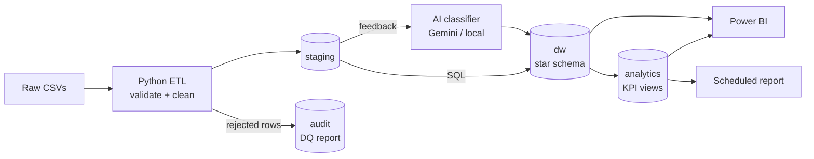

# AutoSphere Analytics — Business Intelligence & AI Analytics Platform

An end-to-end BI and AI analytics platform for **AutoSphere Analytics**, a *fictional*
automotive and mobility company with branches across Georgia (Tbilisi, Batumi, Kutaisi,
Rustavi, Zugdidi). It covers vehicle sales, spare parts, service centers and customer feedback.

> **Portfolio project.** The company is fictional and all data is synthetic and
> generated locally. No real company, customer or employee data is used.

## Business problem

Management needs one trusted view of sales, service and customer satisfaction
across branches. Raw operational data is messy: it has duplicates, inconsistent
city names, invalid IDs and mixed date formats. Customer feedback arrives as free
text in Georgian and English. This platform:

1. **Cleans and validates** the raw data with an explicit Data Quality framework.
2. **Models** it into a PostgreSQL **star schema** data warehouse.
3. **Exposes KPIs** (revenue, profit, margin, AOV, growth, repeat rate) through SQL views.
4. **Classifies feedback with AI/NLP** (sentiment and topic), turning text into structured data.
5. **Visualizes** everything in **Power BI** dashboards.

## Architecture



Full details are in [docs/architecture.md](docs/architecture.md).

## Technology stack

| Area | Tools |
|------|-------|
| Language | Python 3.10+ (pandas, SQLAlchemy) |
| Database / DWH | PostgreSQL (managed, or local via Docker Compose) |
| Transformations | Python (cleaning), SQL (dimensional modelling, KPIs) |
| BI | Power BI, DAX |
| AI / NLP | Configurable provider (Gemini), with a deterministic local fallback |
| Testing | pytest |

## Project status

Built incrementally, with each phase reviewed before the next one starts.

| Phase | Scope | Status |
|-------|-------|--------|
| 1 | Architecture and repository setup | ✅ |
| 2 | PostgreSQL setup and database schema | ⏳ |
| 3 | Synthetic raw data generation | ⏳ |
| 4 | ETL / ELT pipeline | ⏳ |
| 5 | Data cleaning and Data Quality framework | ⏳ |
| 6 | Data Warehouse star schema | ⏳ |
| 7 | Analytical SQL and KPI layer | ⏳ |
| 8 | AI/NLP customer feedback analysis | ⏳ |
| 9 | Power BI data model and dashboard specification | ⏳ |
| 10 | Automated reporting | ⏳ |
| 11 | Testing and end-to-end validation | ⏳ |
| 12 | Final documentation and interview preparation | ⏳ |

## Quick start

```bash
# 1. Create a virtual environment and install dependencies
python -m venv .venv
.venv\Scripts\activate            # Windows
# source .venv/bin/activate       # macOS / Linux
pip install -r requirements.txt

# 2. Configure the environment
copy .env.example .env            # Windows (cp on macOS/Linux), then edit values

# 3. (Optional) start a local PostgreSQL instead of a managed one
docker compose up -d

# 4. Verify everything is ready
python scripts/check_environment.py

# 5. Run tests
pytest
```

## Repository structure

```
common/      shared configuration and database connection
data/        raw/ and processed/ datasets (generated, git-ignored)
database/    DDL schemas, analytics views, migrations, seeds
etl/         extract, validation, transform, load, pipeline
analytics/   analytical SQL and KPI queries
ai/          feedback sentiment and topic classification
powerbi/     data model, DAX measures, dashboard specification
scripts/     command-line entry points
tests/       pytest suite
docs/        technical and business documentation
```

## Security

- Secrets live only in `.env`, which is git-ignored. `.env.example` documents the variables.
- Connection strings are masked in all console and log output.
- External AI calls happen only when `AI_PROVIDER` is set explicitly.
