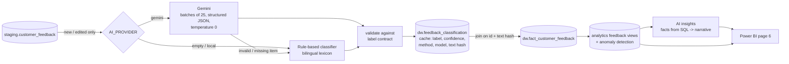

# AI / NLP: Customer Feedback Analytics

> **Purpose:** turn ~10,000 free-text customer comments (Georgian and English) into
> structured data (language, sentiment, topic, confidence) that flows through the same
> warehouse, KPIs and dashboards as sales data. This is not a chatbot. AI is one
> enrichment step inside the BI pipeline.

```powershell
python scripts/classify_feedback.py "სერვისი კარგი იყო, მაგრამ ძალიან დიდხანს მომიწია ლოდინი."
python scripts/classify_feedback.py "Too expensive for a simple oil change" --provider gemini
python scripts/evaluate_ai.py --provider local
python scripts/evaluate_ai.py --provider gemini --sample 300
python scripts/evaluate_ai.py --stored                     # quality of the labels in the warehouse
python scripts/run_pipeline.py --ai-provider gemini        # full pipeline with Gemini (overrides .env)
```

## 1. Why AI here: the business value

Ratings tell management *that* customers are unhappy; text tells them *why*. Without NLP the
comments are unreadable at scale. With it, management can answer:

| Question | Where it is answered |
|----------|----------------------|
| Which branch has the most negative feedback? | `v_sentiment_by_branch` |
| Which complaint topics are increasing? | `v_top_complaint_topics`, `v_feedback_monthly` |
| Are waiting-time complaints increasing, and where? | `v_feedback_anomalies` (Batumi 2026) |
| Does sentiment differ between branches? | `v_sentiment_by_branch` |
| Is service quality improving? | `v_feedback` filtered on `service_quality`, trend by quarter |
| Does product availability cause complaints? | topic `availability` by branch (Zugdidi) |
| What should management look at first? | `v_ai_insights_latest` (narrative per branch) |

The strongest pattern links AI output to operational data. Batumi's waiting-time complaints
rise in 2026 *at the same time* as its median maintenance turnaround rises from about 3h to
7h (`v_service_turnaround`). Text and operations tell the same story, which is what makes
the insight credible.

## 2. Flow



Pipeline steps: **6 NLP enrichment** (before the warehouse build), **7 warehouse**,
**8 views**, **9 insights**. Step 6 commits on its own, so paid model results are kept even
if a later step fails.

## 3. Output contract

| Field | Values |
|-------|--------|
| `feedback_id` | business key |
| `language` | `ka`, `en`, `other` |
| `sentiment` | `positive`, `neutral`, `negative` |
| `topic` | `service_quality`, `waiting_time`, `price`, `staff`, `product_quality`, `availability`, `complaint`, `other` |
| `confidence` | 0–1 |
| `method` / `model` | `gemini` / `gemini-3.5-flash`, `rule_based` / `rules-v1`, `rule_based_fallback` |

**Labelling guideline** (`ai/schema.py`, also sent to the model): *topic = the main subject;
if there is a problem, the topic is the problem. Mixed feedback containing a complaint is
negative.* Example from the requirements:

| Input | language | sentiment | topic |
|-------|----------|-----------|-------|
| სერვისი კარგი იყო, მაგრამ ძალიან დიდხანს მომიწია ლოდინი. | ka | negative | waiting_time |

The contract is enforced three times: by the JSON schema with enums sent to Gemini,
by `validate()` in Python, and by `CHECK` constraints on `dw.feedback_classification`.

## 4. Two classifiers

| | Gemini (`AI_PROVIDER=gemini`) | Rule-based fallback (default) |
|--|--|--|
| How | Structured output (`response_schema`), temperature 0, minimal thinking, few-shot examples, labelling guideline in the system prompt | Bilingual lexicon (Georgian stems). Phrases are matched before words; the clause after "but / მაგრამ" decides; mixed praise and complaint counts as negative |
| Throughput | 25 items per request, 4 parallel requests: ~10k items in ~8–9 min | ~10k items in < 1 s |
| Cost | ~0.6M tokens for the full dataset; afterwards only new or edited feedback | free |
| Determinism | temperature 0 (near-deterministic) | fully deterministic |
| Use | production labels | tests, CI, offline development, per-item fallback |

### Robustness of the Gemini integration

- **Validation per item.** Unknown labels, missing IDs or an out-of-range confidence send *that item* to the rule-based classifier, marked `rule_based_fallback`. Nothing is guessed silently.
- **Retries.** 429 and 5xx responses are retried with exponential backoff and jitter (up to 5 attempts). Other errors fail fast and the batch falls back.
- **Cost guard.** `AI_MAX_EXTERNAL_PER_RUN` caps the items sent per run. Overflow gets local labels and is upgraded automatically on later runs.
- **Cache.** The results table is keyed by `feedback_id` plus `md5(text)`. Unchanged feedback is never re-sent. Edited feedback, or fallback labels when Gemini is available, are re-classified.
- **No secrets in code.** The key comes from `AI_API_KEY` or `GEMINI_API_KEY`; an API key alone never triggers calls, the provider must be chosen explicitly.

## 5. Validation: does it work?

Two ground-truth sets (`python scripts/evaluate_ai.py`):

1. **Generated:** every synthetic feedback with the generator's labels (template phrasing).
2. **Held-out:** 40 hand-written items (20 Georgian, 20 English) with **phrasing that does
   not occur in the templates** (`ai/eval/holdout_feedback.csv`). This is the honest test.

| Classifier | Generated: sentiment | Generated: topic | **Held-out: sentiment** | **Held-out: topic** | Held-out: both |
|-----------|-----:|-----:|-----:|-----:|-----:|
| Rule-based | 100% | 100% | 27.5% | 35.0% | 10.0% |
| Gemini | 95.7% | 98.0% | **100%** | **97.5%** | 97.5% |

**Interpretation.** The rule-based classifier looks perfect on the generated data only
because its lexicon was written while looking at the same templates. It doesn't generalize
to new wording. Gemini handles unseen Georgian and English phrasing. The single held-out
"miss" ("Everything went smoothly from booking to pickup, thank you!") is genuinely
ambiguous between `service_quality` and `other`. **This gap is the reason to use an LLM**;
the rules stay as a free, deterministic fallback.

Gemini scores below 100% on the generated set (full warehouse run, 10,352 items) mostly
because of mild-sentiment templates: 302 of the 444 sentiment disagreements are template
"neutral" read as positive ("Waiting time was acceptable."), 98 are neutral read as
negative ("took longer than expected, but it was fine"). These are borderline cases, not
clear mistakes.

Further validation signals stored with every run:

| Signal | Where | Expectation |
|--------|-------|-------------|
| AI sentiment vs the customer's own star rating | `v_rating_vs_sentiment` | high agreement; the ~3% deliberate contradictions in the data show up as `contradict` |
| Fallback share | warehouse check `fallback_label_share` (WARNING above 2%) | close to 0 |
| Coverage | warehouse check `feedback_classified` (CRITICAL) | 100% of feedback labelled |
| Label distribution and confidence per method | `v_ai_classification_quality` | stable between runs; a sudden shift means drift |
| Confidence calibration | evaluation report | higher confidence should mean higher accuracy |

## 6. Monitoring AI quality in production

1. **Drift:** compare the label distribution of new feedback with the previous month (`v_feedback_monthly`); a jump in one topic is either a real business event or a model problem, so check both.
2. **Human review loop:** sample low-confidence labels (`confidence < 0.6`) and labels where AI sentiment contradicts the star rating, have a person label them, add them to the held-out set, and re-run `evaluate_ai.py`.
3. **Model changes:** `AI_MODEL` is configuration. Before switching models, run the evaluation on the held-out set and compare.
4. **Lineage:** every warehouse row carries `classification_method` (e.g. `gemini:gemini-3.5-flash`), so a dashboard number can always be traced to the model that produced it.

## 7. Anomaly detection and AI insights

**Anomalies** (`v_feedback_anomalies`, deterministic SQL). For each branch × topic × quarter,
negative feedback is compared with that cell's own baseline, the average of the previous 4
quarters on a gap-free quarter spine. A cell is an anomaly when it is at least 2× its baseline
**and** has at least 8 cases (to ignore small-number noise).

**Insights** (`ai/insights.py`, table `dw.feedback_insights`). Facts are computed in SQL:
negative rate vs the same quarter last year, top complaint topics, anomalies, and maintenance
turnaround. The model only writes a 3-bullet narrative plus one action from those facts. It is
told to use no other numbers, and the exact facts JSON is stored next to every text. Without
a provider, a deterministic template writes the narrative from the same facts.

> **Why not let the LLM analyse the raw data?** LLMs are good at language and unreliable at
> arithmetic. Keeping the numbers in SQL makes every insight reproducible and auditable.

## 8. Limitations

- **Synthetic data.** Real feedback is messier (typos, slang, mixed languages, sarcasm). The held-out set is small (40 items). A real deployment needs a few hundred human-labelled examples.
- **Self-reported confidence.** An LLM's confidence is not a calibrated probability. Use it for ranking (what to review first), not as an exact accuracy.
- **One topic per feedback.** Comments that cover two issues are reduced to the main one. Multi-label topics are a possible extension.
- **Privacy.** Feedback text is sent to an external API. In production, remove personal data (names, phone numbers) before sending, and check the provider's data-processing terms.
- **Cost and latency.** The first full classification takes minutes; incremental runs only process new feedback.
