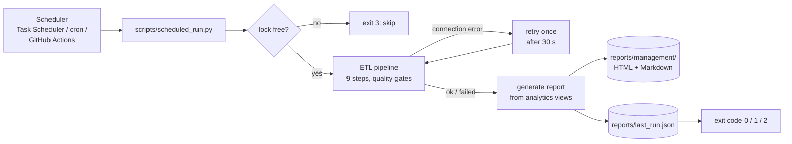

# Automated Reporting

> **Goal:** show that the analytics refresh themselves without anyone pressing a button.
> Every morning the data is reloaded, checked and published, and management receives a
> one-page report saying what needs attention.

```powershell
python scripts/scheduled_run.py      # the scheduled job: refresh + report (what the scheduler runs)
python scripts/generate_report.py    # report only, from the current database
start reports\management\latest.html # open the latest report (Windows)
```

## 1. What runs



| Step | Code | Notes |
|------|------|-------|
| Lock | `reporting/job.py` `RunLock` | A lock file stops two overlapping runs from writing the same tables. A lock older than 2 h is treated as abandoned (crashed run). |
| Refresh | `etl/pipeline.py` | The full pipeline: extract → clean → source gate → staging + checks → NLP → warehouse + checks → views + checks → insights. Runs as `triggered_by = scheduler` in `audit.pipeline_runs`. |
| AI | `--ai-provider local` (default) | An unattended job **never spends API credit unless explicitly told to**. Existing Gemini labels and insights are reused from the cache (`dw.feedback_classification`, identical facts in `dw.feedback_insights`), so the report keeps the model-written narrative at no cost. `--ai-provider gemini` sends only new or edited feedback. |
| Report | `reporting/` | `data.py` reads the analytics views, `alerts.py` applies the alert rules, `render.py` writes HTML and Markdown. |
| Status | `reports/last_run.json` | Machine-readable result of the last run, for monitoring. |

The report **computes nothing itself**. Every figure comes from the same SQL views as
Power BI, so the report and the dashboard cannot disagree.

## 2. When it runs

| Scheduler | Schedule | Setup |
|-----------|----------|-------|
| **Windows Task Scheduler** (laptop / office server) | daily 07:00 | see below |
| **cron** (Linux server) | daily 07:00 | `0 7 * * * cd /opt/autosphere && .venv/bin/python scripts/scheduled_run.py >> logs/cron.log 2>&1` |
| **GitHub Actions** (cloud, no machine needed) | daily 03:00 UTC (07:00 Tbilisi) + manual button | `.github/workflows/scheduled-report.yml`; needs the repository secret `DATABASE_URL` and does nothing without it |

**Why 07:00?** Source extracts are delivered overnight. The run takes about 2–3 minutes, so
the report is ready before the working day starts. A Power BI Service scheduled refresh set
for 07:30 then picks up the same data.

### Windows Task Scheduler

One command in PowerShell creates the task (run once; adjust the path):

```powershell
schtasks /Create /TN "AutoSphere Daily Report" /SC DAILY /ST 07:00 /F `
  /TR "powershell.exe -NoProfile -ExecutionPolicy Bypass -File \"C:\path\to\project\scheduling\run_scheduled.ps1\""

schtasks /Run /TN "AutoSphere Daily Report"      # test it now
schtasks /Query /TN "AutoSphere Daily Report" /V /FO LIST | findstr /C:"Last Result" /C:"Next Run"
schtasks /Delete /TN "AutoSphere Daily Report" /F   # remove it
```

`scheduling/run_scheduled.ps1` uses the project's virtual environment, writes all output to
`logs/scheduled_YYYY-MM-DD.log` and returns the job's exit code, which Task Scheduler shows as
*Last Run Result*.

## 3. What it produces

| Output | Content |
|--------|---------|
| `reports/management/management_report_YYYY-MM-DD.html` | Self-contained page (no external files) for e-mail or the intranet |
| `reports/management/management_report_YYYY-MM-DD.md` | The same content in Markdown (Teams / Slack / Git) |
| `reports/management/latest.html` | Always the newest report (stable link) |
| `reports/last_run.json` | `status`, `exit_code`, `pipeline_run_id`, errors, alert counts by severity |
| `logs/autosphere.log`, `logs/scheduled_*.log` | Step-by-step log of every run |
| Database | Refreshed `dw` / `analytics` / `bi` data, a new row in `audit.pipeline_runs`, quality results in `audit.data_quality_report` |

**Report sections:**
1. Alerts, by severity.
2. Headline KPIs: comparable year-to-date revenue, orders, order value, margin and service revenue vs prior YTD.
3. Branch table: YTD growth, last 3 months, trend, negative feedback rate and rating.
4. AI summary of customer feedback, with its provenance (model or template, period).
5. Top complaint topics.
6. Failed critical checks, when there are any.

### Alert rules (`reporting/alerts.py`)

| Severity | Rule | Example in the current data |
|----------|------|-----------------------------|
| CRITICAL | Today's refresh failed (the report shows the last good run) | - |
| CRITICAL | Critical data-quality check failed | - |
| HIGH | Latest sale older than 31 days (stale data; extracts are monthly) | - |
| HIGH | Branch YTD revenue more than 5% below prior YTD (`trend_status = Declining`) | Kutaisi −16.4% |
| HIGH | Median maintenance turnaround more than 30% above the same quarter last year | Batumi 7.1 h vs 2.8 h |
| HIGH / MEDIUM | Feedback anomaly in the latest quarter (HIGH at ≥ 2× baseline) | Batumi waiting time 2.1×, Kutaisi price 2.5× |
| MEDIUM | More than 2% of AI labels came from the fallback classifier | - |
| INFO | Data-quality warnings and quarantined rows | 52 warnings, 3,046 rows quarantined |

The thresholds are the same ones used in the SQL layer (`v_branch_growth`, business question
10, `v_feedback_anomalies`, the warehouse check `fallback_label_share`). An alert in the report
always matches a flag on the dashboard.

## 4. How failures are handled

| Failure | What happens | Data seen by users | Exit code |
|---------|--------------|--------------------|:---------:|
| **Critical data-quality check** (e.g. duplicate keys after load) | The load transaction **rolls back**. The report is still generated, with a red *Refresh failed* banner and a CRITICAL alert naming the last good run. The failing checks are listed in the report. | Yesterday's data, clearly labelled | 1 |
| **Database unreachable / connection dropped** | Retried once after 30 s (`--retries`, `--retry-delay`). If it still fails, same as above. A data-quality failure is **never** retried, because it would fail the same way. | Last good data | 1 |
| **Gemini unavailable** (only with `--ai-provider gemini`) | Per item fallback to the rule-based classifier (`rule_based_fallback`); the next run upgrades those labels. The insight narrative falls back to the template. | Complete, slightly less accurate labels | 0 |
| **Report generation error** (e.g. disk full) | Logged; `last_run.json` has `report_error` | Refreshed data, no new report | 2 |
| **Previous run still active** | Skipped, nothing touched | Unchanged | 3 |
| **Scheduler itself did not run** | No new report; `reports/last_run.json` → `finished_at` and Power BI page 8 → *Last Refresh* show the age of the data | Unchanged | - |

**Who notices a failure?**
- **Task Scheduler** shows *Last Run Result* ≠ 0; *Triggers → On an event* can e-mail on failure.
- **GitHub Actions** marks the run red and sends the repository owner an e-mail by default; the report and logs are attached to every run as an artifact.
- **Power BI** page 8 (Data Quality & Pipeline) shows the status of the last run to every user.

**Principle:** *a failed refresh must never produce wrong numbers, only old numbers that are
clearly labelled as old.* The rollback guarantees the first part; the banner and the
`last good run` alert guarantee the second.

## 5. Deliberately not done (and how to add it)

| Not included | Why | How to add it |
|--------------|-----|---------------|
| Sending e-mail | Needs SMTP credentials, and the project must work without secrets | Add a step after `generate_report` that sends `latest.html` with `smtplib`; credentials in env vars |
| Airflow / Prefect orchestration | One daily job with a linear flow does not need a workflow engine | Each pipeline step is already a function; wrap them as tasks when there are many jobs with dependencies |
| Incremental loads | Full rebuild takes ~2 min at this size and is simpler to reason about | Load only new partitions per date; facts are already keyed by date |
