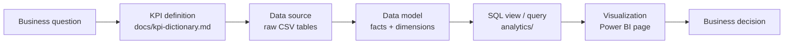

# Business Requirements

> **Context.** AutoSphere Analytics is a *fictional* automotive company in Georgia. It sells
> vehicles, parts and accessories, runs service centres, and collects customer feedback in
> Georgian and English. All data is synthetic. The requirements below simulate what
> management, branch and service managers would ask a BI team for.

## Overall business need

> *"Management needs one trusted view of sales, service and customer satisfaction across all
> branches, refreshed automatically, so that problems are noticed in weeks, not at year end."*

| Stakeholder | Needs | Served by |
|-------------|-------|-----------|
| Management board | Company performance, growth, where to intervene | Power BI page 1, management report |
| Sales director | Revenue drivers, products, channels, customers | Pages 2, 4, 5 |
| Regional / branch managers | Branch comparison and trends | Page 3 |
| Service managers | Workload, turnaround, service profitability | Page 6 |
| Quality / customer experience | Why customers are unhappy, where, and since when | Page 7 (AI) |
| BI team / data owners | Whether today's numbers can be trusted | Page 8, `audit` schema |

## Non-functional requirements

| ID | Requirement | Implementation |
|----|-------------|----------------|
| NFR-1 | One definition per KPI; the dashboard, SQL and report never disagree | KPI views in `analytics`, `bi` layer for Power BI, reconciliation checks every run |
| NFR-2 | Bad source data must not reach the dashboards | Data quality gates; quarantine with reason; rollback on CRITICAL |
| NFR-3 | Daily refresh without manual work | `scripts/scheduled_run.py` + Task Scheduler / cron / GitHub Actions |
| NFR-4 | Customer contact data is not exposed in reports | `bi` views exclude e-mail, phone, VIN; checked every run |
| NFR-5 | Works without paid services; AI cost is controlled | Rule-based fallback, label cache, cost budget, local mode by default |
| NFR-6 | Reproducible | Deterministic generator (seed), idempotent pipeline, 238 tests, end-to-end check |

## How a requirement becomes a dashboard

Every requirement below follows this chain. The **current answer** is what the synthetic data
shows today (data through 2026-09-30); it is reproduced by `python scripts/run_analytics.py --all`.

---

## BR-01 · Which branch generates the most revenue?

| Step | Detail |
|------|--------|
| Stakeholder | Management board |
| KPI | Revenue, Profit, Profit Margin %, Revenue Share % (current year) |
| Data source | `sales.csv`, `branches.csv` |
| Data model | `fact_sales` × `dim_branch`, `dim_date` |
| SQL | `analytics/sql/01_branch_revenue_ranking.sql` on `analytics.v_branch_performance` |
| Visualization | Page 3: bar chart of branches by revenue; table with rank, margin, share |
| Decision | Where to invest in stock and staff; which branch to benchmark against |
| **Current answer** | **Tbilisi Vake** leads with 2.36M GEL (26.5% share), then Tbilisi Didube (1.97M). Batumi Parts Store is the smallest by revenue but has the highest margin (37.8%), because it sells parts, not vehicles. |

## BR-02 · Which products are most profitable?

| Step | Detail |
|------|--------|
| Stakeholder | Sales director, category managers |
| KPI | Profit, Profit Margin %, Revenue, Units |
| Data source | `sales.csv`, `products.csv`, `product_categories.csv` |
| Data model | `fact_sales` × `dim_product`, `dim_category` |
| SQL | `02_most_profitable_products.sql` on `v_product_performance` |
| Visualization | Page 4: scatter (revenue vs margin, size = units) with quadrants; ranked table |
| Decision | Protect availability of profit drivers; review pricing of low-margin volume items |
| **Current answer** | The top profit product is an all-season tyre (444k GEL profit at 30% margin), ahead of the best-selling SUV (409k at 7.5%). Vehicles bring revenue, tyres and consumables bring margin. |

## BR-03 · Which branches have declining revenue?

| Step | Detail |
|------|--------|
| Stakeholder | Management board, regional managers |
| KPI | YTD revenue vs prior-year YTD (comparable period), orders YoY |
| Data source | `sales.csv`, `branches.csv` |
| Data model | `fact_sales` × `dim_branch`, `dim_date` (YTD flags) |
| SQL | `03_declining_branches.sql` on `v_branch_growth` (`trend_status`) |
| Visualization | Page 1: branch YoY bar (red below 0); page 3 drill-through |
| Decision | Root-cause review (traffic, staffing, stock, competition) |
| **Current answer** | **Kutaisi** is the only declining branch: **−16.4% YTD**, driven by **27.9% fewer orders** (traffic problem, not price). Flagged automatically in the daily report. |

## BR-04 · What is the repeat customer rate?

| Step | Detail |
|------|--------|
| Stakeholder | Marketing / CRM |
| KPI | Repeat Customer Rate = customers with 2+ orders / customers with 1+ order |
| Data source | `sales.csv`, `customers.csv` |
| Data model | `fact_sales` × `dim_customer` (SCD2; counted by `customer_id`) |
| SQL | `04_repeat_customer_rate.sql` on `v_kpi_by_year` / `v_kpi_summary` |
| Visualization | Page 5: KPI card + trend by year |
| Decision | Loyalty programme targets; a falling rate signals a retention problem |
| **Current answer** | 66.3% over the whole period; ~48% within a full calendar year (2024: 47.6%, 2025: 48.3%). 2026 shows 40.8% only because the year is not finished, a caveat documented in the query. |

## BR-05 · Which service categories generate the most revenue?

| Step | Detail |
|------|--------|
| Stakeholder | Service managers |
| KPI | Service Revenue, Service Margin %, orders, average order value |
| Data source | `service_orders.csv`, `service_items.csv` |
| Data model | `fact_service_orders`, `fact_service_items` × `dim_category` |
| SQL | `05_service_category_revenue.sql` on `v_service_type_performance`, `v_service_revenue_by_category` |
| Visualization | Page 6: bar by service type (tooltip margin) |
| Decision | Capacity planning (bays, technicians) and parts stocking |
| **Current answer** | **Repair** earns the most (1.60M GEL), **maintenance** is the most frequent (36% of orders). Labour is 44% of service revenue at 54% margin. Body work has the highest order value (1,070 GEL). |

## BR-06 · Which branches have the highest complaint rate?

| Step | Detail |
|------|--------|
| Stakeholder | Quality / customer experience, management |
| KPI | Negative Feedback Rate % (AI sentiment), average rating |
| Data source | `customer_feedback.csv` (free text) |
| Data model | `fact_customer_feedback` (AI labels) × `dim_branch`, `dim_date` |
| SQL | `analytics.v_sentiment_by_branch` |
| Visualization | Page 7: 100% stacked bar by branch and sentiment |
| Decision | Which branch gets a customer-experience review first |
| **Current answer** | **Batumi**: 53.4% negative in 2026 (40.0% over all years), the highest of all branches and well above its own history. |

## BR-07 · What are the most common customer complaints?

| Step | Detail |
|------|--------|
| Stakeholder | Quality / customer experience |
| KPI | Negative feedback by topic, share of negatives, latest quarter vs same quarter last year |
| Data source | `customer_feedback.csv` |
| Data model | `fact_customer_feedback` (AI topic) |
| SQL | `analytics.v_top_complaint_topics` |
| Visualization | Page 7: bar by topic; trend lines per topic |
| Decision | Fix the root cause behind the biggest complaint category |
| **Current answer** | **Waiting time** is the #1 complaint (24.9% of all negatives; 110 in 2026-Q3 vs 67 a year earlier). **Price** complaints nearly tripled (83 vs 30). |

## BR-08 · Has customer sentiment improved over time?

| Step | Detail |
|------|--------|
| Stakeholder | Management board |
| KPI | Negative Rate % by year/quarter, Net Sentiment Score, Avg Rating |
| Data source | `customer_feedback.csv` |
| Data model | `fact_customer_feedback` × `dim_date` |
| SQL | `analytics.v_feedback_monthly` |
| Visualization | Page 7: trend line; KPI card with change in percentage points vs last year |
| Decision | Whether customer-experience initiatives are working |
| **Current answer** | **No, it got worse in 2026**: negative rate 33.5% (2024) → 32.3% (2025) → **39.0% (2026)**, average rating 3.32 → 3.10. |

## BR-09 · Which products have low sales but high margin?

| Step | Detail |
|------|--------|
| Stakeholder | Category managers |
| KPI | Revenue rank vs margin rank (compared with peer medians) |
| Data source | `sales.csv`, `products.csv` |
| Data model | `fact_sales` × `dim_product`, `dim_category` |
| SQL | `06_low_sales_high_margin.sql` on `v_product_performance` |
| Visualization | Page 4: scatter quadrant "Niche: low sales, high margin" |
| Decision | Cross-selling, shelf placement, bundling with service visits |
| **Current answer** | Accessories and car care: trunk organizer (62% margin), CarPlay adapter (61%), interior cleaner (57%). Easy add-ons for service customers. |

## BR-10 · Where should management investigate operational issues?

| Step | Detail |
|------|--------|
| Stakeholder | Service managers, management |
| KPI | Median / P90 service turnaround vs same quarter last year (flag at +30%) |
| Data source | `service_orders.csv` (opened / closed timestamps) |
| Data model | `fact_service_orders` × `dim_branch`, `dim_date` |
| SQL | `10_operational_issues.sql` on `v_service_turnaround` |
| Visualization | Page 6: turnaround trend by branch; matrix with conditional formatting |
| Decision | Staffing or process review where turnaround deteriorates |
| **Current answer** | **Batumi** maintenance: median **7.1 h** in 2026-Q3 vs 2.8 h a year earlier (+154%), flagged INVESTIGATE since Q2. |

## BR-11 · Are complaints unusual, or normal noise?

| Step | Detail |
|------|--------|
| Stakeholder | Quality, management |
| KPI | Negative comments per branch × topic × quarter vs its own 4-quarter baseline (anomaly at ≥ 2× and ≥ 8 cases) |
| Data source | `customer_feedback.csv` |
| Data model | `fact_customer_feedback` × `dim_branch`, `dim_date` |
| SQL | `analytics.v_feedback_anomalies` |
| Visualization | Page 7: anomaly table with data bars; alert in the daily report |
| Decision | Act on real changes, not on random variation |
| **Current answer** | Three anomalies in 2026-Q3: Batumi waiting time (52 cases, 2.1×), Kutaisi price (15, 2.5×), Tbilisi Gldani price (11, 2.2×). **Batumi's complaint spike matches its turnaround problem (BR-10)**: two independent data sources tell the same story. |

## BR-12 · Can we trust today's numbers?

| Step | Detail |
|------|--------|
| Stakeholder | BI team, data owners, every dashboard user |
| KPI | Checks run, critical failures, warnings, rows quarantined, last refresh status |
| Data source | Pipeline metadata |
| Data model | `audit.pipeline_runs`, `audit.data_quality_report`, `audit.rejected_rows` |
| SQL | `audit.v_quality_summary_by_run`, `audit.v_latest_quality_report` |
| Visualization | Page 8: status card (red/amber/green), failed checks table, run history |
| Decision | Publish today's numbers, or investigate first |
| **Current answer** | Last run: 340 checks, **0 critical**, 52 warnings; 3,046 of 113,531 source rows (2.7%) quarantined with a reason. Raw rows = staging + quarantined in every table: nothing is lost silently. |

---

## Requirements traceability

| Req. | KPI dictionary | SQL | Power BI page | Daily report | Test |
|------|----------------|-----|---------------|--------------|------|
| BR-01 | Revenue, Profit, Margin, Share | `01_*.sql` | 3 | branch table | `test_headline_kpis_match_independent_queries` |
| BR-02 | Profit, Margin | `02_*.sql` | 4 | - | `test_every_analytical_query_runs_and_returns_rows` |
| BR-03 | YTD growth | `03_*.sql` | 1, 3 | HIGH alert | `test_branch_trend_status_follows_the_documented_rule` |
| BR-04 | Repeat Customer Rate | `04_*.sql` | 5 | - | `test_repeat_rate_recomputed_in_pandas` |
| BR-05 | Service Revenue | `05_*.sql` | 6 | KPI card | `test_service_order_grain_aggregates_its_lines` |
| BR-06 | Negative Rate | `v_sentiment_by_branch` | 7 | branch table | `test_ai_sentiment_largely_agrees_with_star_ratings` |
| BR-07 | Complaints by topic | `v_top_complaint_topics` | 7 | complaints table | `test_every_feedback_in_the_warehouse_has_ai_labels_with_lineage` |
| BR-08 | Negative Rate trend | `v_feedback_monthly` | 7 | AI summary | `test_insights_exist_for_company_and_every_branch` |
| BR-09 | Margin vs revenue rank | `06_*.sql` | 4 | - | `test_every_analytical_query_runs_and_returns_rows` |
| BR-10 | Turnaround | `10_*.sql` | 6 | HIGH alert | end-to-end check, `test_report_from_live_data` |
| BR-11 | Anomaly ratio | `v_feedback_anomalies` | 7 | HIGH alert | `test_anomaly_detection_flags_batumi_waiting_time_in_2026` |
| BR-12 | DQ status | `audit` views | 8 | CRITICAL alert | `test_failed_load_keeps_previous_staging_data` |
