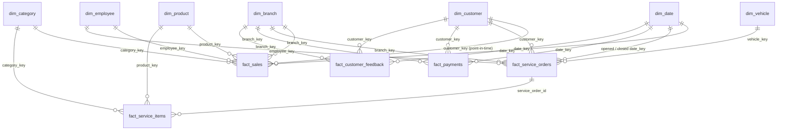

# Data Model

The database is organized into four schemas, each representing one layer of the platform.

| Schema | Layer | Keys | Rebuilt each run? | Who reads it |
|--------|-------|------|-------------------|--------------|
| `staging` | Clean source entities | Business (natural) keys | Yes | ETL (to build `dw`), DQ checks, AI pipeline |
| `dw` | Star schema warehouse | Surrogate keys | Yes (full refresh) | Power BI, `analytics` views |
| `analytics` | KPI / reporting views | — | Views (always current) | Power BI, automated reports |
| `audit` | Pipeline metadata | Identity columns | No (history kept) | Engineers, DQ dashboard |

---

## 1. Staging layer — the data contract

Staging contains data **after** Python validation and cleaning. Its constraints act as
a second line of defense. If a cleaning bug ever let an invalid row through,
PostgreSQL would reject the load rather than let it reach the warehouse.

Staging deliberately has **no foreign keys**. Each table can then be truncated
and reloaded on its own, and referential integrity is checked by the DQ framework
instead. Real foreign keys are enforced in `dw`.

### Master data

| Table | Grain (one row per…) | Business key | Notable rules |
|-------|----------------------|--------------|---------------|
| `branches` | branch | `branch_id` | `branch_type` ∈ {sales_and_service, sales_only, service_only} |
| `product_categories` | product category | `category_id` | unique name; `business_line` ∈ {vehicles, parts, accessories, consumables} |
| `products` | product (vehicle model, part, accessory) | `product_id` | `list_price > 0`, `unit_cost >= 0` |
| `employees` | employee | `employee_id` | role/department from fixed lists |
| `customers` | customer | `customer_id` | individuals need first and last name, corporates need a company name; unknown city → `'Unknown'` |
| `vehicles` | customer-owned vehicle | `vehicle_id` | VIN unique and 17 characters |

### Transactions

| Table | Grain (one row per…) | Business key | Notable rules |
|-------|----------------------|--------------|---------------|
| `sales` | invoice line | `sale_line_id` | `quantity > 0`; `discount_amount <= quantity × unit_price`; `unit_cost` stored at time of sale (needed for correct historical profit) |
| `service_orders` | service visit (work order) | `service_order_id` | `closed_at >= opened_at`; completed orders must have `closed_at` |
| `service_items` | labour or part line on a service order | `service_item_id` | part lines require `product_id`; labour hours may be fractional |
| `payments` | payment attempt | `payment_id` | `amount > 0`; currency is always `GEL`; references an invoice or a service order |
| `customer_feedback` | feedback submission | `feedback_id` | non-empty free text (Georgian/English); optional 1–5 rating |

**Why is `unit_cost` stored on each sale line?** Product costs change over
time. Calculating historical profit with *today's* cost from `products` would
misstate past margins. Storing the cost at transaction time is how ERP systems
record cost of goods sold.

**Order vs line:** an *order* is an `invoice_number`, and a *line* is one product
on that invoice. Average Order Value therefore divides revenue by **distinct
invoices**, not by line count.

---

## 2. Audit layer

| Table | Purpose |
|-------|---------|
| `pipeline_runs` | One row per execution: start and end time, status, row counts (JSONB), error message. |
| `data_quality_report` | One row per check per run: `check_name`, `table_name`, `status` (PASS/FAIL), `severity` (INFO/WARNING/CRITICAL), `failed_rows`, `message`, `executed_at`. `stage` separates checks on raw source data from post-load checks. |
| `rejected_rows` | Quarantine for every row removed during cleaning, with the reason and the original record as JSONB. Nothing is dropped silently. |

All three link to `pipeline_runs.run_id`, so every number on a dashboard can be traced back to the run that produced it.

---

## 3. Warehouse layer (star schema)

Built from staging with set-based SQL (ELT) in `database/warehouse/*.sql`. The files run in
filename order inside one transaction, followed by the warehouse quality gate.

### Why a star schema

- **Simple joins:** every question is "fact joined to a few dimensions". Power BI is designed for exactly this shape.
- **Conformed dimensions:** `dim_date`, `dim_branch`, `dim_customer` and `dim_category` are shared by
  several facts, so "revenue by branch" and "complaints by branch" slice by the *same* branch definition.
- **Measures computed once:** net amount, cost and profit are calculated in the load, not re-derived in every report.

### Dimensions

| Table | Grain | Keys | Key attributes | SCD |
|-------|-------|------|----------------|-----|
| `dim_date` | calendar day, 2016–2027 | `date_key` (YYYYMMDD), unique `full_date` | day/week/month/quarter/year labels, weekend, Georgian public holidays | static |
| `dim_branch` | branch | `branch_key` SK, `branch_id` BK | city, region, type, `offers_sales`, `offers_service` | Type 1 |
| `dim_category` | product category | `category_key`, `category_id` | category name, business line | Type 1 |
| `dim_product` | product | `product_key`, `product_id` | brand, category (denormalized), list price, list margin %, price band | Type 1 |
| `dim_customer` | **customer version** | `customer_key` SK, `customer_id` BK | name, type, city, region, loyalty tier, contact data, `valid_from`, `valid_to`, `is_current` | **Type 2** |
| `dim_vehicle` | vehicle | `vehicle_key`, `vehicle_id` | make/model, model year, age band, fuel, transmission | Type 1 |
| `dim_employee` | employee | `employee_key`, `employee_id` | role, department, home branch | Type 1 |

**Special members.** `-1 = Unknown` exists in every dimension. A fact never holds a NULL
dimension key: a master-data gap kept by the ETL policy (for example a product with an
invalid category) maps to `-1`, so its revenue is still counted. `-2 = Not applicable` is
used for labour lines, which have no product.

### SCD decision

| Choice | Attributes | Why |
|--------|------------|-----|
| **Type 2** on `dim_customer` | `customer_type`, `city`, `loyalty_tier` | These drive segmentation. If a customer moves from Rustavi to Batumi, past revenue must stay attributed to Rustavi, otherwise historical city reports would silently change. |
| Type 1 on `dim_customer` | name, email, phone, registration date | Corrections, not business history. They are overwritten on all versions. |
| Type 1 on other dimensions | all | Changes are rare and rewriting history is acceptable (a product rename should show everywhere). This is easy to switch to Type 2 if the business needs it. |

How Type 2 works (`04_dim_customer_scd2.sql`):

1. On the first load, each customer gets one version valid from `1900-01-01` to `9999-12-31`.
2. When a tracked attribute changes, the current version is closed (`valid_to = as_of - 1`) and a new current version starts on `as_of`.
3. A second change on the same day updates that day's version in place, so windows never overlap.
4. Facts use a **point-in-time lookup**: `transaction_date BETWEEN valid_from AND valid_to`.

Try it without changing any data: `python scripts/demo_scd2.py` (it runs in a transaction and rolls back).

### Facts

| Table | Grain | Degenerate keys | Measures | Notes |
|-------|-------|-----------------|----------|-------|
| `fact_sales` | one invoice line | `sale_line_id` (PK), `invoice_number` | quantity, unit price/cost, gross, discount, **net (revenue)**, cost, **profit** | `is_revenue_recognized` = completed only (cancelled and returned lines are kept for analysis but excluded from revenue). `category_key` is carried on the fact so Power BI can filter by category without a snowflake. |
| `fact_service_orders` | one service order | `service_order_id` (PK) | labour hours, labour revenue, parts revenue, total revenue, cost, profit, **turnaround hours**, item count | Two date roles: opened and closed. Aggregated from its lines; the gate verifies that order revenue = sum of line revenue. |
| `fact_service_items` | one labour or part line | `service_item_id` (PK), `service_order_id` | quantity, unit price/cost, revenue, cost, profit | Supports "service revenue by category" (parts) vs labour. Warranty lines carry 0 revenue. |
| `fact_payments` | one payment attempt | `payment_id` (PK), `source_reference` | amount, **net cash** (completed +, refunded −, failed 0) | Branch is inherited from the paid invoice or service order. |
| `fact_customer_feedback` | one feedback submission | `feedback_id` (PK) | rating | Holds the text and the **AI columns** (language, sentiment, topic, confidence, method), filled by the NLP step (`ai/pipeline.py`). |

### Relationships: logical foreign keys

Fact-to-dimension relationships are **logical foreign keys**: they are declared in the
model and verified after every build, but not enforced by per-row database triggers. With
enforced FKs, 6 trigger checks ran per inserted fact row (189k checks for `fact_sales`
alone), which made the bulk load about 6× slower. Integrity is guaranteed instead by:

- unknown members, so every lookup resolves (`COALESCE(key, -1)`);
- 23 set-based `fk_*` checks in the warehouse gate (CRITICAL; one anti-join each);
- reconciliation checks: row counts and revenue in each fact equal staging.

This is the common data-warehouse practice. Integrity is enforced by the load process,
while the database is optimized for bulk loading and querying.

### Load strategy

| Object | Strategy | Reason |
|--------|----------|--------|
| Dimensions | upsert on business key (`ON CONFLICT DO UPDATE`), never deleted | stable surrogate keys across runs, so Power BI relationships keep working |
| `dim_customer` | SCD2 merge | history preserved |
| Facts | full rebuild (`TRUNCATE` + `INSERT ... SELECT`) | always consistent with staging; ~90k fact rows rebuild in seconds |

**Scale-up path:** load facts incrementally (only new or changed date partitions),
partition large facts by month, and add aggregate tables for very large date ranges.

### Warehouse quality gate (runs inside the build transaction)

| Check group | Examples | Severity |
|-------------|----------|----------|
| Reconciliation with staging | row counts of every fact; sales net amount; service revenue (rounded per line, like an invoice); payment amounts | CRITICAL |
| Internal consistency | order revenue = sum of its lines | CRITICAL |
| SCD2 integrity | exactly one current version per customer; no overlapping windows; every customer has a current version | CRITICAL |
| Logical FKs | 23 relationships | CRITICAL |
| Date dimension | contiguous (required for Power BI time intelligence) | CRITICAL |
| Unknown-member usage | sales with unknown customer/product (a load bug) → CRITICAL; unknown category or employee home branch (master-data gap) → WARNING | mixed |

On the default dataset, all CRITICAL checks pass. The 2 WARNINGs are 1,589 sales lines of
the product with an invalid category (revenue kept, category shown as "Unknown") and 2
employees with an unknown home branch.

### Row counts (default dataset)

| Table | Rows |
|-------|-----:|
| dim_date | 4,383 |
| dim_customer | 5,001 (5,000 + unknown) |
| dim_vehicle | 2,001 |
| dim_employee | 91 |
| dim_product | 42 (40 + unknown + labour) |
| dim_category | 14 |
| dim_branch | 9 |
| fact_sales | 31,440 |
| fact_service_orders | 10,879 |
| fact_service_items | 26,165 |
| fact_payments | 24,499 |
| fact_customer_feedback | 10,352 |
