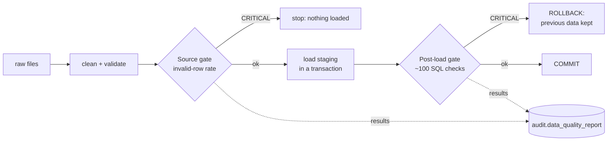

# Data Quality Framework

> **Goal:** every number on a dashboard can be trusted, *and we can prove it*. Each check has a
> severity. Results are stored per run in `audit.data_quality_report`, and critical problems
> stop the pipeline before bad data becomes visible.

```powershell
python scripts/run_pipeline.py          # pipeline with both quality gates
python scripts/run_quality_checks.py    # re-check data currently in PostgreSQL (read-only)
python scripts/run_quality_checks.py --all
```

## Two stages, two gates



| Stage | What is measured | Source of truth |
|-------|------------------|-----------------|
| `source` | Raw-file quality: one result per rejection reason (`rejected_negative_quantity`) and per automatic repair (`fixed_city_normalized`), plus the **invalid-row rate** per table and the **schema contract** per file | The cleaning step itself (`etl/transform/cleaners.py`), so the rules that clean and the rules that measure can't drift apart |
| `post_load` | ~100 declarative SQL checks on the loaded staging tables | `etl/validation/rules.py` |
| `warehouse` | Star schema: row/amount reconciliation with staging, SCD2 integrity, logical foreign keys, unknown-member usage, AI label coverage | `warehouse_checks()` |
| `analytics` | KPI views reconcile to the facts; **Power BI layer** (`bi`): unique dimension keys, no fact row outside its dimension, totals and YTD equal to SQL, no contact-data columns | `analytics_checks()`, `bi_checks()` |

**Why run the post-load checks inside the load transaction?** If a check fails, the whole
load is rolled back. Dashboards keep showing the last good data instead of half-broken
numbers. The report is written in a *separate* transaction, so the evidence of the failure
survives the rollback.

## Severity policy

| Severity | Meaning | Pipeline behavior | Examples |
|----------|---------|-------------------|----------|
| **CRITICAL** | Reported numbers would be wrong | Stop / roll back | duplicate primary keys, orphan transactions, negative quantities or amounts, future transactions, non-GEL payments, completed order without close time, invalid-row rate > 10%, missing file or column |
| **WARNING** | Usable but degraded | Load and report | master-data references kept by policy (unknown category, branch or owner), non-canonical city, completeness below tolerance, invalid-row rate > 2%, completed invoice without payment |
| **INFO** | Measurement for monitoring | Report only | automatic fixes, rating completeness |

## Check catalog (post-load)

Each check is SQL that **counts violating rows**. The builders in
`etl/validation/checks.py` generate it, so adding a rule is a single line.

| Category | Builder | Example | Severity |
|----------|---------|---------|----------|
| Existence | `min_rows` | every staging table has rows | CRITICAL |
| Uniqueness | `unique` | `sale_line_id` unique | CRITICAL |
| Null values | `not_null` | `sales.customer_id` not NULL | CRITICAL |
| Referential integrity (transactions) | `foreign_key` | `sales.product_id` exists in `products` | CRITICAL |
| Referential integrity (master) | `foreign_key(..., WARNING)` | `products.category_id` exists | WARNING |
| Allowed values | `allowed_values` | `order_status` ∈ {completed, cancelled, returned}; customer city canonical | CRITICAL / WARNING |
| Dates | `not_future`, `condition` | no future sales; service closes after it opens | CRITICAL |
| Quantities and money | `positive`, `non_negative`, `condition` | quantity > 0, amount > 0, discount ≤ line value, currency = GEL | CRITICAL |
| Completeness | `not_null(..., max_failed_ratio=…)` | email ≤ 10% missing, unknown city ≤ 5% | WARNING |
| Business consistency | `condition` | completed invoices have a completed payment (≤ 2% tolerance); no service at sales-only branches | WARNING |

Spot-check (`failed_rows` and `total_rows` are stored for every check):

```text
severity  status stage     table               check            failed
WARNING   FAIL   post_load staging.employees   fk_branch_id          2   <- employees with unknown branch (kept by policy)
WARNING   FAIL   post_load staging.products    fk_category_id        1
WARNING   FAIL   post_load staging.vehicles    fk_customer_id       10
CRITICAL  PASS   post_load staging.sales       fk_customer_id        0
```

## The report

`audit.data_quality_report` has one row per check per run, with columns `run_id`, `stage`,
`check_name`, `table_name`, `column_name`, `status`, `severity`, `failed_rows`, `total_rows`,
`message` and `executed_at`.

Monitoring views:

| View | Use |
|------|-----|
| `audit.v_latest_quality_report` | latest result of every check, including `failed_pct` |
| `audit.v_quality_summary_by_run` | per run: number of checks, critical failures, warnings, rejected rows (trend) |

```powershell
python scripts/inspect_database.py --query "SELECT * FROM audit.v_quality_summary_by_run ORDER BY run_id"
python scripts/inspect_database.py --query "SELECT severity, table_name, check_name, failed_rows, failed_pct FROM audit.v_latest_quality_report WHERE status='FAIL' ORDER BY severity, failed_rows DESC"
```

## Proving completeness: reconciliation with the generator

The synthetic data generator records every defect it injected
(`data/raw/_generation_manifest.json`). Tests prove that:

- **every one of the 38 injected defect types is detected**, either by a source-stage
  check or, for master-data defects kept by policy, by a post-load WARNING;
- self-contained defects reconcile **exactly**: 129 injected negative quantities produce
  129 `rejected_negative_quantity`;
- `loaded + rejected = raw` for every table;
- a broken export (30% corrupted rows) stops the pipeline before loading;
- an orphan transaction introduced after loading fails a CRITICAL check and is rolled back.

In a real system there is no manifest. The same tests then run against **known bad
fixtures**, and the report trend (`v_quality_summary_by_run`) shows when a source system
starts producing more defects than usual.

## Interpreting the default run

| Finding | Interpretation | Action |
|---------|----------------|--------|
| `sales` invalid-row rate 2.4% (WARNING) | the source sends negative quantities, unknown products and future dates | raise with the source-system owner; data is still loaded |
| `payments.rejected_orphan_source_reference` = 292 | mostly a cascade from rejected service orders and invoices | fix the parent records upstream |
| 4 master-data WARNINGs | references kept and mapped to "Unknown" in the warehouse | correct the master data; revenue isn't lost |
| 0 CRITICAL | staging is safe to build the warehouse from | proceed |

## Limitations and next steps

- Thresholds (2% / 10%, completeness tolerances) are static. A natural next step is
  anomaly detection on the run history, for example alerting when today's rejection rate is
  three times the 30-day average.
- Checks run sequentially (~100 short queries, ~10 s on a remote database). Fine at this
  scale; they could be batched into fewer queries if needed.
- Warehouse-level checks (fact-to-dimension keys, reconciliation of revenue between staging
  and warehouse) are added in Phase 6.
