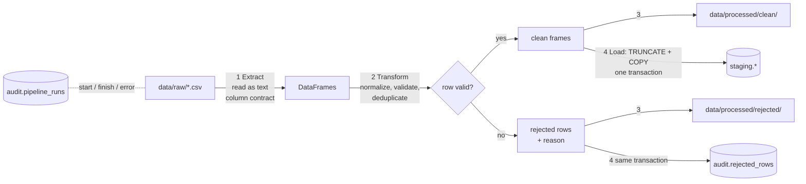

# ETL Pipeline

```powershell
python scripts/run_pipeline.py              # full run, loads PostgreSQL
python scripts/run_pipeline.py --dry-run    # extract + clean only (no database needed)
```

## Flow



| Step | Module | What happens |
|------|--------|--------------|
| 1. Extract | `etl/extract/csv_extractor.py` | Reads every value as **text** (`dtype=str`, `keep_default_na=False`), so `N/A`, `0012` or `245,00` aren't silently converted. Validates the column contract in `etl/sources.py`: a missing file, a missing column or an empty file raises `SchemaValidationError` and stops the run. Extra columns are dropped with a warning. |
| 2. Transform | `etl/transform/cleaners.py`, `normalize.py`, `mappings.py` | Cleans each table in dependency order (parents first). See the rules below. |
| 3. Persist | `etl/pipeline.py` | Writes clean and rejected CSVs to `data/processed/`, for inspection without a database. |
| 4. Load | `etl/load/staging_loader.py`, `audit.py` | Full refresh: `TRUNCATE` every staging table, then bulk `COPY`. Rejected rows go to `audit.rejected_rows` **in the same transaction**, so either everything commits or nothing does, and the previous staging data survives a failed run. |

Every run is recorded in `audit.pipeline_runs` (start and end time, status, row counts per
table, error message). Logs go to the console and `logs/autosphere.log`.

## Cleaning rules (per table, in order)

1. **Exact duplicates.** Identical raw rows are removed, and the first copy is kept.
2. **Normalization:**

   | Data | Rule | Example |
   |------|------|---------|
   | Business keys | trim, uppercase, remove spaces | ` cus00012 ` → `CUS00012` |
   | Dates | 5 explicit formats, **day-first**, never guessed | `04/03/2025`, `04.03.2025`, `04-Mar-2025` → 2025-03-04 |
   | Money | decimal comma and thousands separator handled | `245,50` → 245.50, `1,245.00` → 1245.00 |
   | Categories | lowercase, spaces and hyphens become `_`, synonym table | `In-Store` → `in_store`, `canceled` → `cancelled`, `labour` → `labor`, `gasoline` → `petrol` |
   | Cities | synonym table including Georgian script | `Tbilsi`, `TBILISI`, `თბილისი` → `Tbilisi`; empty → `Unknown` |
   | Names | title-case values written in all caps or all lowercase | `BERIDZE` → `Beridze` |
   | Email | lowercase, NULL when malformed | `broken#example.com` → NULL |
3. **Business rules.** A row is rejected with the **first** rule it fails (one clear reason per row).
4. **Referential integrity.** Each foreign key is checked against the parent's *cleaned* keys.
5. **Business-key de-duplication.** After normalization, `cus00001` and `CUS00001` are the
   same customer, so the first valid row is kept (`duplicate_business_key`). Vehicles are also
   de-duplicated on VIN, keeping the lowest `vehicle_id`.

## Master data vs transactions

| | Transactions (sales, service orders/items, payments, feedback) | Master data (customers, products, employees, vehicles, branches, categories) |
|--|--|--|
| Invalid measure, key or date | **Reject**: row is quarantined with a reason | Set the attribute to **NULL** and keep the row |
| Unknown reference | **Reject** (`orphan_*`) | **Keep and flag** for the DQ report; mapped to an "Unknown" member in the warehouse |

**Why?** Rejecting a product because of a bad category would also drop every valid sale of
that product. A master-data defect should degrade one attribute, not lose revenue.

## Cascades

Rejecting a parent row correctly invalidates its children:

- service items of a rejected service order are rejected as `orphan_service_order_id`;
- payments for a rejected service order, or for an invoice whose lines were all rejected, are rejected as `orphan_source_reference`;
- a feedback reference to a rejected order or invoice is set to NULL, and the feedback itself is kept.

This is why `service_items` and `payments` show more orphan rejections than were injected
directly. The difference is fully explained by rejected parents.

## Results on the default dataset (seed 42)

| Table | Raw | Loaded | Rejected | Main reasons |
|-------|----:|-------:|---------:|--------------|
| customers | 5,075 | 5,000 | 75 | exact duplicates, same key with cosmetic differences |
| vehicles | 2,020 | 2,000 | 20 | exact duplicates, duplicate VIN |
| sales | 32,533 | 31,440 | 1,093 | duplicates, negative quantities, unknown product/customer/branch/employee, future dates |
| service_orders | 11,088 | 10,879 | 209 | duplicates, unknown vehicle, closed before opened |
| service_items | 26,952 | 26,165 | 787 | cascade from rejected orders, duplicates, negative quantities |
| payments | 25,102 | 24,499 | 603 | cascade (unknown source), duplicates, negative/zero amounts, USD |
| customer_feedback | 10,605 | 10,352 | 253 | duplicates, empty text, unknown customer/branch, future dates |

**No row is lost unaccounted:** `loaded + rejected = raw` for every table (tested).

## Idempotency and reruns

Every run rebuilds staging from the raw files. Running the pipeline twice gives the same
staging contents. `audit.pipeline_runs` and `audit.rejected_rows` keep history across runs.

## Inspecting results

```powershell
python scripts/inspect_database.py --query "SELECT * FROM audit.pipeline_runs ORDER BY run_id DESC"
python scripts/inspect_database.py --query "SELECT source_table, reason, count(*) FROM audit.rejected_rows WHERE run_id = (SELECT max(run_id) FROM audit.pipeline_runs WHERE status='success') GROUP BY 1,2 ORDER BY 3 DESC"
```
