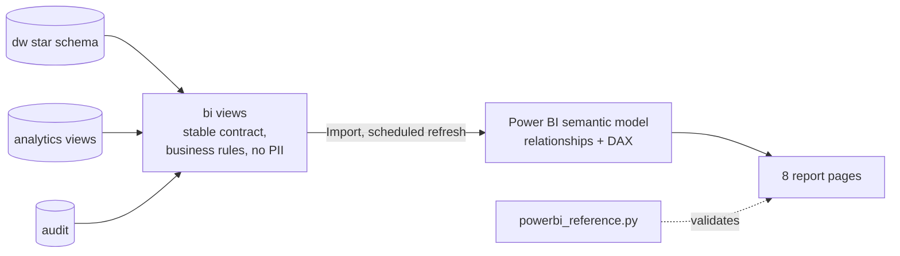

# Power BI Layer

Power BI is the presentation layer of AutoSphere Analytics. It contains **no business logic of
its own**: it imports the `bi` views from PostgreSQL, adds DAX measures, and visualises them.

| File | Content |
|------|---------|
| [data-model.md](data-model.md) | Tables, relationships, star schema, SCD2 handling, model settings |
| [dax-measures.md](dax-measures.md) | All DAX measures (sales, time intelligence, service, payments, AI feedback, data quality) |
| [dashboard-spec.md](dashboard-spec.md) | 8 report pages: business questions, visuals, fields, decisions |
| [theme/autosphere-theme.json](theme/autosphere-theme.json) | Report theme (colours, fonts) |
| `../database/views/10_bi.sql` | The semantic layer Power BI imports |
| `../database/security/powerbi_reader.sql` | Optional read-only login for Power BI |
| `../scripts/powerbi_reference.py` | Expected values to validate the report |

> The `.pbix` file is built in Power BI Desktop by following these documents. It is not
> committed: binary files do not diff or review well, and the report would contain a copy of
> the data. The documents are the source of truth; the `.pbix` is a build output.

## Architecture



**Why not let Power BI read `dw` directly?**
1. **Stable contract.** Warehouse tables can be refactored without breaking the report.
2. **One definition of revenue.** "Completed sales only" is applied in SQL once; the report cannot accidentally include cancelled orders.
3. **Privacy and security.** Contact data (e-mail, phone, VIN) never reaches the report. A read-only login can be limited to the `bi` schema.
4. **Tested.** Every pipeline run checks the layer (unique keys, no orphan facts, totals equal to SQL, no PII columns). See `bi_checks()` in `etl/validation/rules.py`.

## Build the report (Power BI Desktop, Windows)

**1. Prepare the data.** Run the pipeline once so the views contain data:

```powershell
python scripts/run_pipeline.py
python scripts/powerbi_reference.py      # values to compare with later
```

**2. Connect.** Get Data → **PostgreSQL database**:

| Field | Value |
|-------|-------|
| Server | host from `DATABASE_URL` (the part after `@` and before `/`), e.g. `xxxx.frankfurt-postgres.render.com` |
| Database | database name from `DATABASE_URL` (the part after the last `/`) |
| Data Connectivity mode | **Import** |
| Credentials | *Database* authentication: user and password from `DATABASE_URL` (or the `powerbi_reader` login) |

The connection is encrypted (SSL). Never paste credentials into the report or into this
repository; Power BI stores them in its own credential store.

**3. Select tables.** In the Navigator, select the 17 views of the `bi` schema, then
**Transform Data** and rename them as in [data-model.md](data-model.md#tables)
(e.g. `bi.fact_sales` → `Sales`). Close & Apply.

**4. Model.** In Model view:
- Delete any relationships Power BI created automatically. Then create the relationships from the table in data-model.md. Set `closed_date_key` as **inactive**.
- Mark `Date` as date table (`full_date`); disable Auto date/time.
- Apply the *Model settings* checklist (sort by column, hide keys, formats).

**5. Measures.** Enter Data → empty table named `_Measures`. Add the measures from
[dax-measures.md](dax-measures.md) and use its headings as display folders.

**6. Theme.** View → Themes → Browse for themes → `powerbi/theme/autosphere-theme.json`.

**7. Pages.** Build the 8 pages from [dashboard-spec.md](dashboard-spec.md).

**8. Validate.** With no filters, the cards must equal the output of
`python scripts/powerbi_reference.py` (e.g. Revenue, Revenue CY YTD, Revenue YTD YoY % = 15.6%,
Kutaisi YTD YoY = −16.4%). A difference means a wrong relationship or measure. The most
common causes are a relationship on the wrong key, or counting `customer_key` instead of
`customer_id`.

## Refresh

| Where | How |
|-------|-----|
| Power BI Desktop | Home → Refresh (after `run_pipeline.py`) |
| Power BI Service | Publish → dataset settings → enter the database credentials → Scheduled refresh *after* the nightly pipeline run (e.g. pipeline 06:00, refresh 07:00). Depending on tenant and network settings, PostgreSQL may need an on-premises data gateway. |

The pipeline only replaces data after all CRITICAL checks pass (otherwise it rolls back).
A scheduled refresh therefore always reads the last **good** data. Page 8 shows whether the
last run succeeded.

## Row-level security (optional extension)

To let each branch manager see only their branch, add a small mapping table
*Branch Access* (`user_email`, `branch_name`), then Modeling → Manage roles → role
*Branch Manager* with this filter on `Branch`:

```dax
[branch_name]
    = LOOKUPVALUE ( 'Branch Access'[branch_name], 'Branch Access'[user_email], USERPRINCIPALNAME () )
```
 It is not needed for the portfolio
demo; the star schema supports it because every fact is filtered through `Branch`.
