# Power BI Data Model

The report imports **only the `bi` schema** (`database/views/10_bi.sql`). Each view becomes
one table in Power BI and is renamed as shown below. Business rules (which sales count as
revenue, which service orders are complete) are applied in SQL, so DAX stays simple and every
number matches the SQL KPI layer.

## Tables

| Power BI table | Source view | Rows (current data) | Role |
|----------------|-------------|------:|------|
| **Date** | `bi.dim_date` | ~1.1k | Date dimension, marked as date table (`full_date`) |
| **Branch** | `bi.dim_branch` | 9 | Conformed dimension, used by every fact |
| **Category** | `bi.dim_category` | 14 | Product category and business line |
| **Product** | `bi.dim_product` | 42 | Product attributes |
| **Customer** | `bi.dim_customer` | ~5k | SCD Type 2: one row per customer version, plus current RFM segment |
| **Employee** | `bi.dim_employee` | 91 | Sales and service staff |
| **Vehicle** | `bi.dim_vehicle` | ~2k | Serviced vehicles (no VIN) |
| **Sales** | `bi.fact_sales` | ~30k | Fact: recognized sales lines (grain: invoice line) |
| **Service Orders** | `bi.fact_service_orders` | ~10k | Fact: completed service orders (grain: order) |
| **Service Items** | `bi.fact_service_items` | ~26k | Fact: labor and parts lines of service orders |
| **Payments** | `bi.fact_payments` | ~24k | Fact: every payment attempt, including failed and refunded |
| **Feedback** | `bi.fact_customer_feedback` | ~10k | Fact: feedback with AI labels (language, sentiment, topic, confidence) |
| **Feedback Anomalies** | `bi.feedback_anomalies` | ~700 | Pre-computed branch × topic × quarter vs 4-quarter baseline |
| **AI Insights** | `bi.ai_insights` | 9 | Latest narrative per branch and company |
| **DQ Results** | `bi.dq_results` | ~300 | Checks of the latest pipeline run |
| **DQ Run History** | `bi.dq_run_history` | 1 row / run | Checks, failures and rejected rows per run |
| **Pipeline Runs** | `bi.pipeline_runs` | 1 row / run | Status, duration, trigger |
| **_Measures** | (Enter Data, empty) | | Holds all DAX measures (`dax-measures.md`) |

## Relationships

All relationships are **many-to-one, single direction** (dimension filters fact). Only one is
inactive.

```mermaid
erDiagram
    Date ||--o{ Sales : date_key
    Date ||--o{ "Service Orders" : "opened_date_key (active)"
    Date ||--o{ "Service Orders" : "closed_date_key (INACTIVE)"
    Date ||--o{ "Service Items" : date_key
    Date ||--o{ Payments : date_key
    Date ||--o{ Feedback : date_key
    Branch ||--o{ Sales : branch_key
    Branch ||--o{ "Service Orders" : branch_key
    Branch ||--o{ "Service Items" : branch_key
    Branch ||--o{ Payments : branch_key
    Branch ||--o{ Feedback : branch_key
    Branch ||--o{ "Feedback Anomalies" : branch_key
    Category ||--o{ Sales : category_key
    Category ||--o{ "Service Items" : category_key
    Product ||--o{ Sales : product_key
    Product ||--o{ "Service Items" : product_key
    Customer ||--o{ Sales : customer_key
    Customer ||--o{ "Service Orders" : customer_key
    Customer ||--o{ Payments : customer_key
    Customer ||--o{ Feedback : customer_key
    Employee ||--o{ Sales : employee_key
    Employee ||--o{ "Service Orders" : employee_key
    Vehicle ||--o{ "Service Orders" : vehicle_key
```

| From (many) | To (one) | Active | Note |
|-------------|----------|:-----:|------|
| Sales[date_key] | Date[date_key] | ✅ | |
| Sales[branch_key / category_key / product_key / customer_key / employee_key] | dimension key | ✅ | |
| Service Orders[opened_date_key] | Date[date_key] | ✅ | orders are dated by opening (same as SQL KPIs) |
| Service Orders[closed_date_key] | Date[date_key] | ❌ | used with `USERELATIONSHIP` in **Orders Closed** |
| Service Orders[branch_key / customer_key / vehicle_key / employee_key] | dimension key | ✅ | |
| Service Items[date_key / branch_key / category_key / product_key] | dimension key | ✅ | |
| Payments[date_key / branch_key / customer_key] | dimension key | ✅ | |
| Feedback[date_key / branch_key / customer_key] | dimension key | ✅ | |
| Feedback Anomalies[branch_key] | Branch[branch_key] | ✅ | quarter columns are text, used as their own axis |

**Not related on purpose:**
- **Sales ↔ Service Orders ↔ Feedback.** Facts are never joined to each other. They are compared through the shared dimensions (Date, Branch, Customer); that is what makes them *conformed* dimensions.
- **Service Items ↔ Service Orders.** Both are facts at different grains. Order-level KPIs use Service Orders, part/category analysis uses Service Items.
- **Product → Category.** `bi.dim_product` has no category key, so there is exactly one filter path from Category to Sales. Two paths would make the model ambiguous.
- **AI Insights, DQ Results, DQ Run History, Pipeline Runs** are standalone tables with their own slicers.

## Why a star schema (and not one big flat table)?

- **Correct totals at any grain.** Sales lines, service orders and payments have different grains. In one flat table, order-level values would repeat on every line and be double-counted.
- **One filter, every fact.** Selecting "AutoSphere Batumi" on the Branch slicer filters sales, service, payments and feedback at the same time, because they share one Branch table.
- **Smaller and faster.** VertiPaq compresses narrow fact tables with integer keys very well; text attributes are stored once in the dimensions.
- **Simple DAX.** Time intelligence needs a proper date table; a star schema provides it.

## SCD Type 2 customers in Power BI

`Customer` has one row per customer **version** (`valid_from`, `valid_to`, `is_current`).
Facts point to the version that was valid at the transaction date. As a result:

- "Revenue by loyalty tier" uses the tier the customer had **at the time of the sale**. A customer who moved from `silver` to `gold` keeps their earlier revenue under `silver`.
- **Distinct customers** must count `customer_id`, not `customer_key` (one person can have several keys). `bi.fact_sales` therefore carries `customer_id`, and the **Customers** measure counts it.
- For "current attributes only", filter `Customer[is_current] = TRUE` on a customer table visual.

## Model settings (checklist)

1. **Mark as date table:** Date, using `full_date`. Disable *Auto date/time* (File → Options → Data Load).
2. **Sort by column:** `month_name` and `month_short` by `month_number`; `year_month` by `year_month_sort`; `day_name` by `day_of_week`.
3. **Hide** all `*_key` columns, `year_month_sort`, and fact columns that are only used by measures (amounts). Users should use measures, not drag raw columns.
4. **Summarization:** set `year`, `rating`, `quarter_number`, `month_number`, `model_year` and `odometer_km` to *Don't summarize*.
5. **Data categories:** `Branch[city]` and `Customer[city]` as *City* (map visual).
6. **Formats:** currency measures as `#,0 "₾"` (or `#,0.00`); rates as percentage with 1 decimal.
7. **Unknown members** (`key = -1`, e.g. "Unknown branch") are real rows. Keep them visible in totals; they make data quality gaps visible instead of hiding revenue.

## Storage mode

**Import** for all tables. The data is small (< 150k rows in total), the database is in
another region (~170 ms round trip), and Import gives the fastest visuals and full DAX support.
DirectQuery would send every visual interaction to the database. It is only worth it for
very large or near-real-time data.
